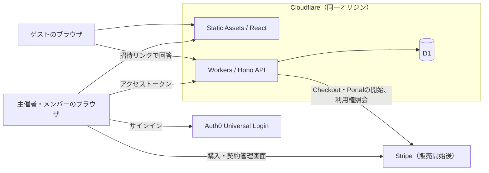

# そろうよ Web版の技術選定

初回はスマートフォンを優先した日本語のWebサービスとして提供する。LINEなどで届いたURLを開くだけで○△×を回答でき、主催者が選んだ日をグループのカレンダーに載せられることを最初の到達点とする。ネイティブアプリは継続利用者から需要が確認できた段階で検討する。その場合もゲストの回答URLはWebで維持する。

この文書は実装に向けた設計案。料金・有料機能の範囲・販売開始時期は別途決める。[プロダクトバックログ #33](https://github.com/Riku10145/sorouyo/issues/33) · [提供範囲の決定 #30](https://github.com/Riku10145/sorouyo/issues/30)

## 採用する構成

| 担当 | 採用技術 | 選定理由 |
| --- | --- | --- |
| 画面 | React、TypeScript、Vite | カレンダーや候補選択をブラウザで操作する。静的ビルドで配布でき、画面表示のたびにサーバーでHTMLを生成する費用がかからない。 |
| 配信・API | Cloudflare Workers Static Assets、TypeScript、Hono | 1回のデプロイで画面と同一オリジンのAPIを公開する。サーバーの常時起動、OS更新、別のAPIホストの管理を省ける。 |
| 入出力 | Hono RPC、Zod | ルート定義からクライアントの型を導き、HTTPで受け取った値も同じスキーマで検証できる。 |
| 永続化 | Cloudflare D1、Drizzle ORM / Kit | グループの所属、候補と投票の関係を外部キーと一意制約で表現できる。TypeScriptのテーブル定義からクエリ型と差分SQLを得られる。 |
| 本人確認 | Auth0 Universal Login、Auth0 React SDK、Worker側の `jose` | 主催者とメンバーのサインイン・アカウント復旧を外部に任せる。登録せず回答するゲストはAuth0を通らない。 |
| 有料販売 | Stripe Billing、ホスト型Checkout、Customer Portal、Entitlements | 支払い画面・決済情報・継続請求・解約・契約による利用権をStripeで管理できる。販売を始める時点で接続する。 |

予定と回答には整合性が必要なので、初期の保存先をD1に一本化する。画面の再表示・操作後に最新データを取得する設計で始めれば、常時接続や同期用のキューも不要になる。Cloudflareで運用するリソースは静的アセット付きWorkerとD1のみ。[Static Assets](https://developers.cloudflare.com/workers/static-assets/) · [D1とDrizzle](https://orm.drizzle.team/docs/connect-cloudflare-d1)

Viteが生成したHTML・JS・CSSと `/r` などの画面はStatic Assetsが配信する。SPAフォールバックを有効にし、`assets.run_worker_first` の対象を `/api/*` に限定する。ページの再読み込みは画面に戻り、存在しないAPIはJSONの404を返す。将来のアプリは同じHTTP APIを利用できる。[Cloudflare Vite plugin](https://developers.cloudflare.com/workers/vite-plugin/) · [ルーティングの仕様](https://developers.cloudflare.com/workers/static-assets/routing/worker-script/)

## AIが変更しても型の食い違いを検出する仕組み

- 1リポジトリ内でブラウザ用とWorker用のTypeScript設定を分け、両方で `strict` と `noUncheckedIndexedAccess` を有効にする。Cloudflareのバインディング・ランタイム型は、採用したcompatibility dateとWrangler設定から `wrangler types` で生成する。[WorkersのTypeScript](https://developers.cloudflare.com/workers/languages/typescript/)
- APIルートをZodバリデーター付きで定義し、投票値は `yes | maybe | no` の列挙型に絞る。成功・入力エラー・受付終了の各レスポンスにはHTTPステータスと判別可能な型を付ける。画面は `import type` したHonoのルート型を `hc<AppType>` に渡す。DB行からは公開項目だけを選び、トークンのハッシュや他グループの情報をレスポンスに含めない。[Hono RPC](https://hono.dev/docs/guides/rpc) · [Zod](https://zod.dev/basics)
- Drizzleのスキーマ変更には生成したSQLマイグレーションを添えてレビューする。実装PRのCIは、ロックファイルからのインストール、型検査、ローカルD1へのマイグレーション、Worker上のAPIテスト、Viteビルドを通す。APIの返却型の変更は呼び出し元の型検査で、権限や同時更新の誤りはリクエストを通すテストで検出する。

## 初期費用と見直しの目安

2026年11月21日に確認した公開料金。無料枠はアカウント内の他サービスでの消費も考慮する。固定費を抑えるため、初回はWorkers Free・D1の無料枠・Auth0 Freeで始め、販売開始までは決済を呼び出さない。

| 課金先 | 初期の目安 | 確認する指標 |
| --- | --- | --- |
| Cloudflare Workers | 静的アセットへの直接リクエストは無料・無制限。Freeの動的リクエストは10万件/日、CPUは1回10ms。Paidはアカウント単位で月額5米ドルから。 | APIリクエスト数、JWT検証を含むCPU時間と上限エラー。[Workers料金](https://developers.cloudflare.com/workers/platform/pricing/) · [アセット料金](https://developers.cloudflare.com/workers/static-assets/billing-and-limitations/) |
| Cloudflare D1 | Freeは読取500万行/日、書込10万行/日、1 DBは500 MB、アカウント合計5 GB。 | 結果件数よりもスキャン行数が効く。月カレンダーと投票集計のクエリごとに読取行数を確認する。[D1料金](https://developers.cloudflare.com/d1/platform/pricing/) · [D1上限](https://developers.cloudflare.com/d1/platform/limits/) |
| Auth0 | B2C Freeは月間アクティブユーザー25,000人まで。 | ログインする主催者・メンバーのMAU。リンク回答だけのゲストはアカウントを作成しない。[Auth0料金](https://auth0.com/pricing) |
| Stripe | 日本の標準料金例はカード決済成功額の3.6%、Billingの従量プランは取引額の0.7%。 | 実売上と決済手段別手数料。独自ドメインの取得・更新料も別途見積もる。[決済料金](https://stripe.com/jp/pricing) · [Billing料金](https://stripe.com/jp/billing/pricing) |

例えば1日1,000件の調整があり、各調整に動的リクエストが20回なら、この経路は2万リクエスト/日になる。月カレンダーの閲覧やリトライは別に加算する。無料枠の上限に近づいたら、まず余分な再取得とD1の全件走査を確認する。公開前の負荷確認で余裕が取れない場合は、上限到達による停止とPaidの費用を比較して切り替える。

## 実装順

1. [#18](https://github.com/Riku10145/sorouyo/issues/18) でWebを起動できる土台と検証環境を作る。Paperを画面の基準にし、PoCのブラウザ内保存とプラン切替は本番の保存・課金処理から切り離す。
2. [#4](https://github.com/Riku10145/sorouyo/issues/4) と [#3](https://github.com/Riku10145/sorouyo/issues/3) で本人確認、所属による認可、D1を接続する。グループ作成から月カレンダーへの登録までを通す。
3. ゲスト回答と確定を別端末で通し、更新の競合やリンクの期限も検証する。[ゲスト回答 #28](https://github.com/Riku10145/sorouyo/issues/28) · [確定 #29](https://github.com/Riku10145/sorouyo/issues/29)
4. 販売条件の決定後にStripeのテスト環境で購入・解約を確認し、販売する段階で本番へ接続する。[課金 #17](https://github.com/Riku10145/sorouyo/issues/17)

データの所有者、操作ごとの認可、回答・確定の整合性、外部サービス障害時の動作は[API・データ・課金の設計](./service-design.md)にまとめた。
